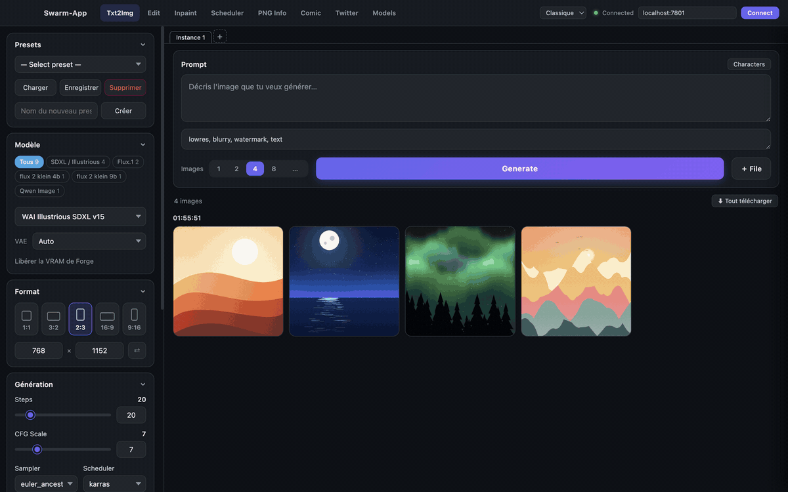
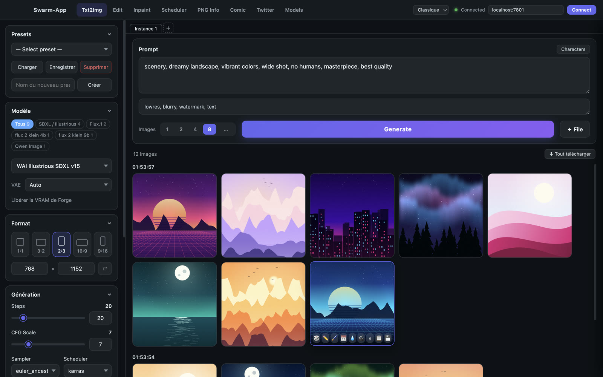
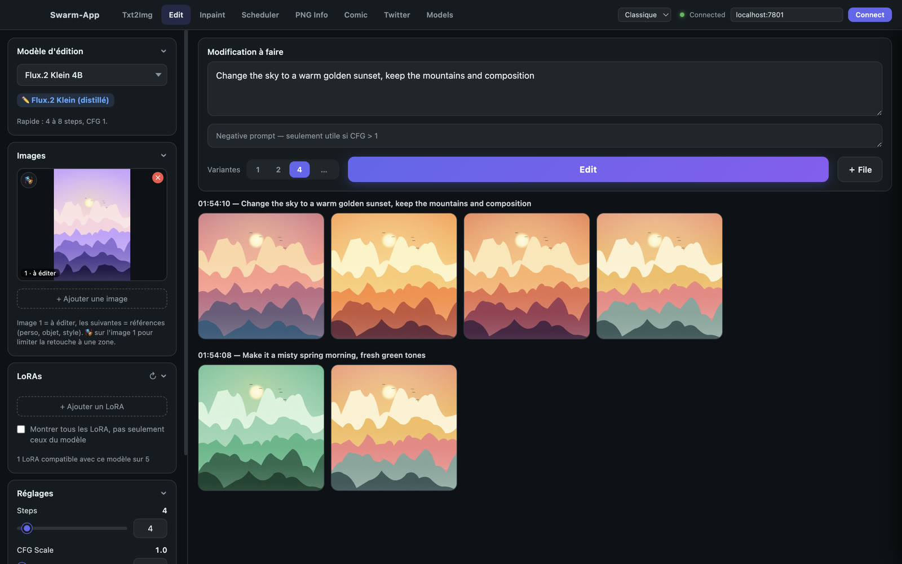
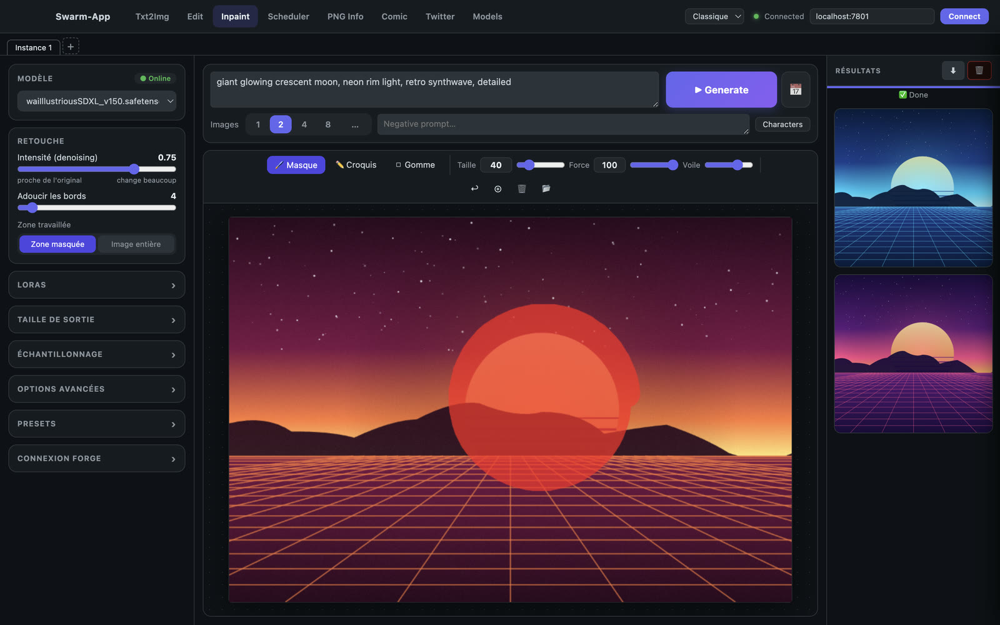
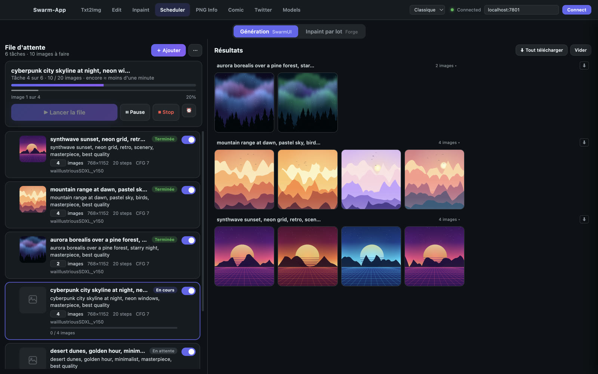
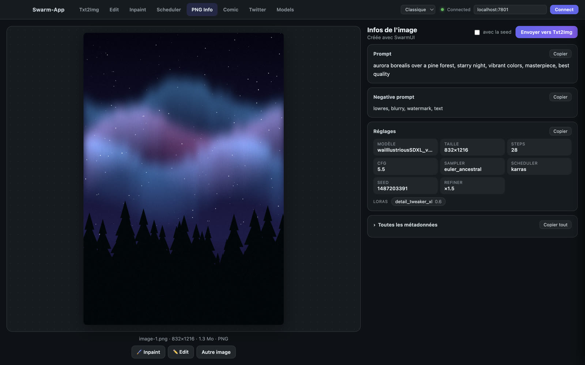
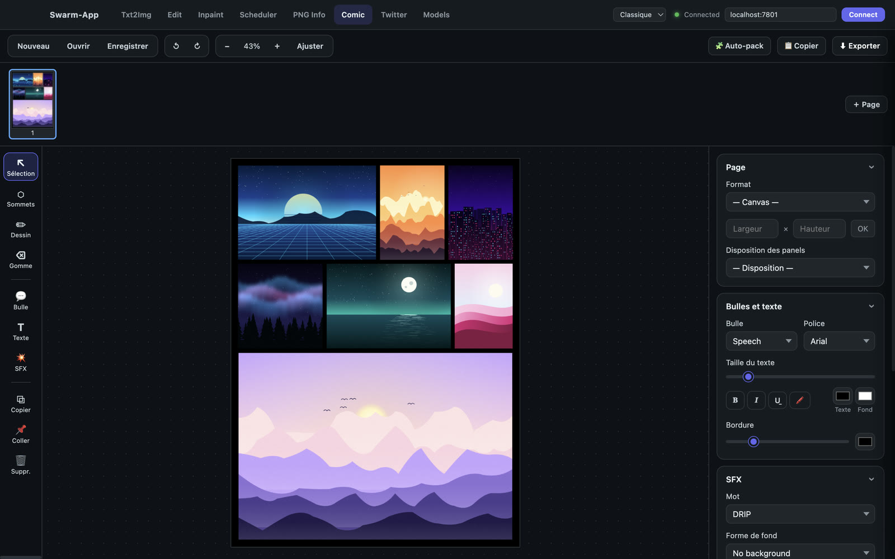
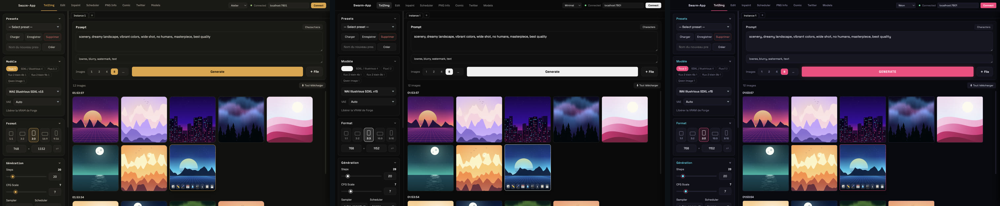

# Swarm-App

A native desktop frontend for [SwarmUI](https://github.com/mcmonkeyprojects/SwarmUI): generate, edit, inpaint, queue and lay out your images in one app.



**[⬇ Download the latest release](https://github.com/Das-debug-a1111/swarmui-app/releases/latest)**: macOS (`.dmg`), Windows (`.exe`), Linux (`.AppImage`). The app updates itself when a new version comes out.

> The images in these screenshots are procedural placeholders, not real generations.

---

## Txt2Img



- Model picker grouped by family (SDXL / Illustrious, Flux, Flux.2 Klein, Qwen…)
- Aspect-ratio presets, sampler, scheduler, LoRAs, VAE, Hires fix / refiner, ControlNet with preprocessors
- 1 / 2 / 4 / 8 / custom images per run, several instances side by side
- Danbooru tag autocomplete in every prompt field
- Local presets, with a warning before overwriting one
- Drag the settings cards to reorder them, paste an image anywhere with ⌘V / Ctrl+V

## Edit



Instruction-based image editing with **Flux.2 Klein**, **Flux.1 Kontext** and **Qwen Image Edit**: describe the change, add reference images, optionally paint a mask to limit the edit to one area. The right defaults (steps, CFG, guidance, shift) are applied for each model.

## Inpaint



Canvas inpainting through Forge: mask / sketch / eraser brushes with editable size, masked-area or whole-picture mode, soft inpainting, LoRAs, several results per run, before/after comparison and full-screen browsing of results.

## Scheduler



Queue generations and let them run unattended:

- Add the current Txt2Img or Edit settings to the queue in one click, edit a task later in its own instance
- Variations, reordering by drag and drop, retries on failure, ETA, resume after a restart, scheduled start
- **Batch inpaint** mode (Forge): several masks per photo, apply the same masks to other photos

## PNG Info



Read the generation settings of any SwarmUI or A1111/Forge image, copy them, or send them straight back to Txt2Img, Edit or Inpaint.

## Comic



Multi-page comic editor: panel layouts, speech bubbles, text, SFX, layers, export to PNG / PDF. **Auto-pack** builds pages from a folder of images of any aspect ratio without cropping them.

## Also included

- **Twitter**: random character challenge, in-tab generation and watermarking before posting
- **Models**: browse CivitAI and download models into your models folder, sorted by type
- **Character Selector**: browse and insert characters from a local dataset

## Themes



Classic, Atelier, Minimal and Néon, switchable from the top bar.

---

## Requirements

- [SwarmUI](https://github.com/mcmonkeyprojects/SwarmUI) running locally or on your network
- Optional: [Forge](https://github.com/lllyasviel/stable-diffusion-webui-forge) with `--api` for the Inpaint tab and batch inpaint

## Run from source

```bash
git clone https://github.com/Das-debug-a1111/swarmui-app.git
cd swarmui-app
npm install
npm start
```

Requires [Node.js](https://nodejs.org/) 18+.

## Configuration

### SwarmUI host

In the top bar, enter your SwarmUI address (default: `localhost:7801`) and click **Connect**. The host is remembered between sessions.

### Forge (Inpaint)

Set the Forge URL in the Inpaint tab's **Connexion Forge** card (for example `http://192.168.1.20:7860`). Forge must be started with `--api`.

### Character Selector data (optional)

The Character Selector reads a local data folder containing:

| File | Description |
|------|-------------|
| `wai_characters.csv` | Character list (name, series) |
| `wai_character_thumbs.json` | Compressed thumbnails |
| `wai_tag_assist.json` | Tag suggestions per character |

On first open of the Character Selector panel, click **Choose folder…** to point the app to your data directory. You can change it later with the 📂 icon in the panel header.

## Build a distributable

```bash
npm run build:mac     # .dmg
npm run build:win     # .exe installer
npm run build:linux   # .AppImage
```

Output goes to the `dist/` folder. Pushing a `v*` tag builds all three on GitHub Actions and publishes a release.

## License

MIT
